<!-- ═══════════════════════════════════════════════════════════════════
     K.A.I.O // CORE — README do perfil @Kaio193
     Cards de stats/troféus/atividade/cobrinha: gerados pela Action
     .github/workflows/cards.yml no branch "output" (sem servidor de terceiro)
     ═══════════════════════════════════════════════════════════════════ -->

<div align="center">



<br/>

<a href="https://github.com/Kaio193">
  
</a>

<br/>


</div>

<br/>

## ⌬ `SOBRE_MIM`

Sou o **Kaio**, estudante do **Técnico em Informática no IFPB** e desenvolvedor de **apps Android nativos em Java**.

Hoje meu foco principal é o **Serpenteando**, meu TCC: um app educacional sobre serpentes brasileiras com **modelo 3D interativo**, quiz, missões e conteúdo em três idiomas.

Também faço **sites para o comércio local** aqui da Paraíba, e cada projeto que eu termino vai pro ar e entra no portfólio.

```java
public class Kaio extends Developer {
    String   local  = "Paraíba, BR";
    String   escola = "IFPB · Técnico em Informática";
    String   foco   = "Android nativo";
    String[] agora  = { "Serpenteando (TCC)", "sites pro comércio local" };
    String   lema   = "aprender construindo";
    boolean  abertoAColaborar = true;
}
```

<br/>

## ⌬ `TECH_STACK`

<div align="center">


<br/><br/>


</div>

<br/>

## ⌬ `FERRAMENTAS`

<div align="center">


</div>

<br/>

## ⌬ `PROJETOS`

<div align="center">

<a href="https://github.com/Kaio193/Serpenteando">
  
</a>

<a href="https://github.com/Kaio193/Bustime"></a>
<a href="https://kaio193.github.io/radia-perlma-ifpb/"></a>

</div>

<br/>

## ⌬ `OBJETIVOS_ATUAIS`

<div align="center">

</div>

<br/>

## ⌬ `SYS.MONITOR`

<div align="center">










</div>

<br/>

<div align="center">
<picture>
  <source media="(prefers-color-scheme: dark)" srcset="https://raw.githubusercontent.com/Kaio193/Kaio193/output/snake.svg"/>
  <source media="(prefers-color-scheme: light)" srcset="https://raw.githubusercontent.com/Kaio193/Kaio193/output/snake-light.svg"/>
  
</picture>
</div>

<br/>

## ⌬ `CONEXÕES`

<div align="center">

<a href="https://github.com/Kaio193"></a>
<a href="https://kaio193.github.io/radia-perlma-ifpb/"></a>
<!-- LINKEDIN: troque SEU-USUARIO pela sua URL (sem %20) e tire o comentário
<a href="https://www.linkedin.com/in/SEU-USUARIO/"></a>
-->
<!-- E-MAIL: só se quiser e-mail público no perfil
<a href="mailto:SEU-EMAIL"></a>
-->

</div>

<br/>

<div align="center">

</div>
