<!-- README do perfil @Kaio193 — v3 (20/11/2026), estrutura inspirada em github.com/sophiahonopato
     (referência escolhida pelo Kaio), com conteúdo real do Kaio e as cores dele (ciano + verde-água).
     Cards de stats e linguagens: Action .github/workflows/cards.yml no branch "output". -->

<div align="center">


</div>

---

## 🤖 KAIO SYSTEM

```bash
╭────────────────────────────────╮
│        KAIO SYSTEM v3.0        │
╰────────────────────────────────╯

Inicializando sistema...

████████████████████ 100%

✔ Desenvolvedor detectado
✔ Android nativo carregado
✔ 7 sites no ar
✔ Automação com IA ativada
✔ Aprendizado contínuo

STATUS: ONLINE 🚀
```

---

## 👨‍💻 Sobre mim

```java
public class Kaio {

    String nome        = "Kaio Dantas de Medeiros";
    String funcao      = "Desenvolvedor Android (Java) e Web";
    String localizacao = "Santa Luzia, Paraíba, Brasil 🇧🇷";

    String formacao    = "Técnico em Informática Integrado ao Ensino Médio — IFPB (2024–2026)";

    String[] foco = {
        "Android nativo em Java",
        "Sites para negócios locais",
        "Automação com n8n",
        "IA aplicada (Claude Code)"
    };

    String[] ferramentas = {
        "Android Studio", "Git", "GitHub", "Vercel",
        "Netlify", "Docker", "Blender", "VS Code"
    };

    String[] paixoes = {
        "Tecnologia", "Psicologia", "Teologia",
        "Oratória", "Mídia e áudio"
    };
}
```

---

## 💙 Minha trajetória

Faço sites desde o primeiro ano do curso técnico, em 2024, no **IFPB campus Santa Luzia**.

No TCC desenvolvi em dupla o **Serpenteando**, um app Android nativo em Java pra ensinar sobre serpentes brasileiras e prevenir acidentes, com modelo 3D interativo, quiz, missões e três idiomas.

Em **novembro de 2026** comecei a atender negócios aqui da região: barbearia, açaiteria, clínica odontológica, centros de treinamento de lutas. Cada site sai com SEO local e métricas no Microsoft Clarity.

Fora do código, estudo **psicologia e teologia**, e isso me ajuda na comunicação, na oratória e no atendimento ao cliente.

> "Aprender construindo."

---

## ⚡ Tecnologias

<div align="center">


</div>

---

## 🎨 Do pedido ao site no ar

Gosto de participar do processo inteiro, da conversa com o cliente até o deploy:

```text
🤝 CONVERSA COM O CLIENTE
   ↓
🔎 PESQUISA DE REFERÊNCIA
   ↓
🎨 MARCA, FOTOS E TEXTO REAIS
   ↓
💻 DESENVOLVIMENTO
   ↓
🧪 TESTE EM 5 TAMANHOS DE TELA
   ↓
🚀 DEPLOY (VERCEL / NETLIFY)
   ↓
📈 SEO + MICROSOFT CLARITY
```

---

## 🚀 Projetos

| 🚀 Projeto | 💡 Sobre |
|---|---|
| 🐍 [**Serpenteando**](https://github.com/Kaio193/Serpenteando) | TCC. App Android nativo em Java: 10 espécies, quiz de 30 questões, missões, modelo 3D (Google Filament), MVP + SQLite, offline e em 3 idiomas |
| 💈 [**LL Barbearia**](https://llbarbearia-sl.vercel.app) | Site para cliente: catálogo de cortes, pedido de valor pelo WhatsApp, modelo 3D feito no Blender |
| 🍇 [**LL Açaí**](https://llacai-sl.vercel.app) | Site para cliente: cardápio clicável e pedido pelo Instagram; sistema de pedido online em desenvolvimento |
| 🥊 [**Pitbull Brothers**](https://pitbullbrothers-sl.vercel.app) | Site para centro de treinamento de lutas: modalidades, horários, mapa e personagem em pixel art |
| 🥋 [**Keka Muay Thai**](https://keka-muaythai-sl.vercel.app) | Site para CT de muay thai: aulas, treinador, mapa e personagem animado |
| 🦷 [**Dentalle**](https://dentalle-sl.vercel.app) | Site para clínica odontológica: tratamentos, casos reais e dente 3D, seguindo as regras do CFO |
| 👩‍💻 [**Radia Perlman**](https://kaio193.github.io/radia-perlma-ifpb/) | Projeto em grupo no IFPB (Web 1): site biográfico no GitHub Pages |
| 🚌 [**BusTime**](https://github.com/Kaio193/Bustime) | Projeto em grupo no IFPB (Web 1): protótipo de site de transporte público |

---

## 🧠 O que estou aprendendo

```bash
> carregando trilha de aprendizado...

[█████████░] Android nativo em Java

[█████████░] HTML, CSS e JavaScript

[████████░░] SEO e performance de sites

[███████░░░] Automação com n8n

[███████░░░] IA aplicada a negócios

[██████░░░░] Back-end (PHP e banco de dados)

[█████░░░░░] Python

STATUS:
Aprender → Construir → Publicar
```

---

## 🌎 Além do código

```text
💻 Tecnologia
🧠 Psicologia
📖 Teologia
🎤 Oratória
🎧 Mídia e edição de áudio
🤝 Atendimento ao cliente
🌱 Aprendizado constante
```

---

## 🎯 Próximos passos

```bash
╭─────────────────────────────────╮
│         MEUS OBJETIVOS          │
╰─────────────────────────────────╯

[█████████░] Concluir o técnico no IFPB (2026)

[████████░░] Publicar o Serpenteando

[████████░░] Mais sites para negócios locais

[███████░░░] Automações com IA para clientes

[██████░░░░] Primeiro estágio em desenvolvimento

PRÓXIMO NÍVEL:
DESENVOLVEDOR JÚNIOR 🚀
```

---

## 📊 GitHub

<div align="center">




</div>

---

## 🌎 Vamos nos conectar?

<div align="center">

<a href="https://github.com/Kaio193">

</a>

<a href="https://www.linkedin.com/in/kaio-dantas193">

</a>

</div>

---

<div align="center">

### 💙 "Aprender construindo."


</div>


